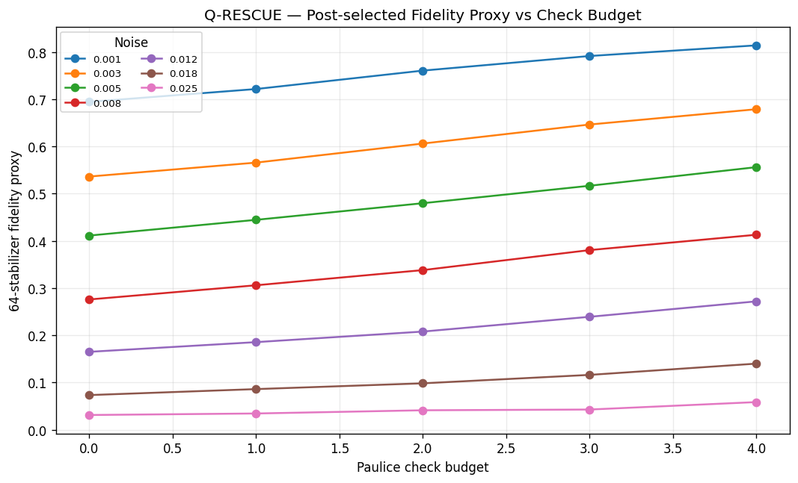
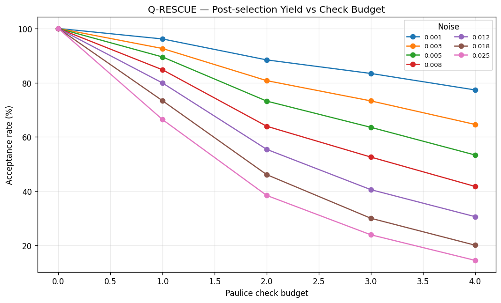
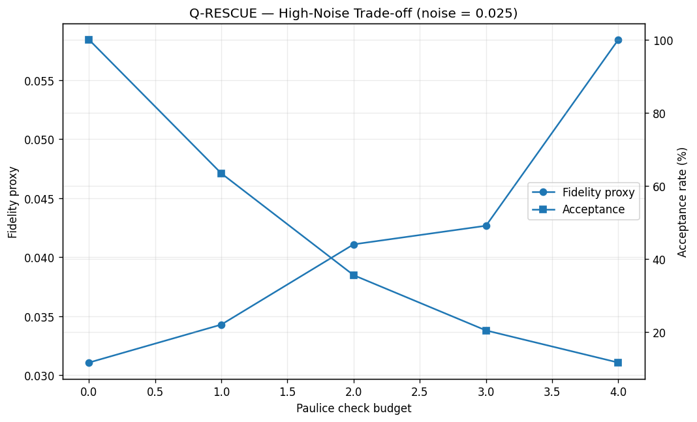
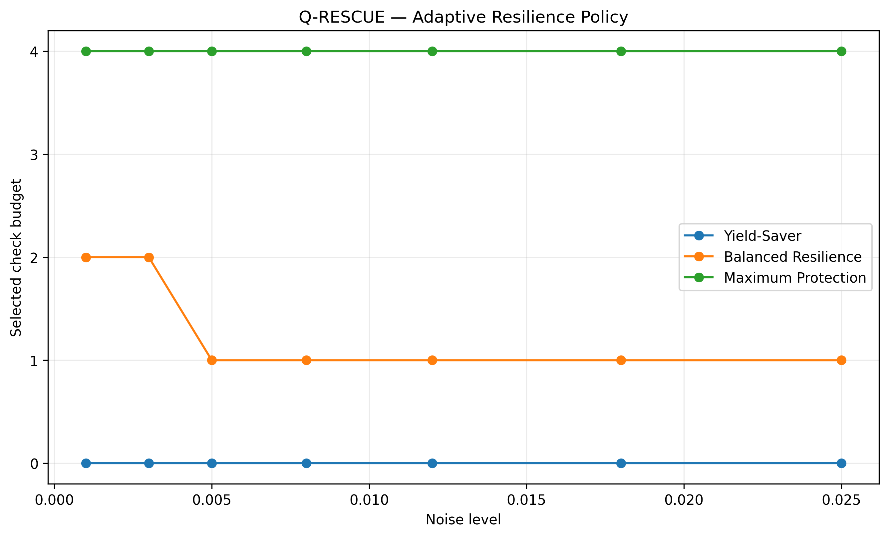
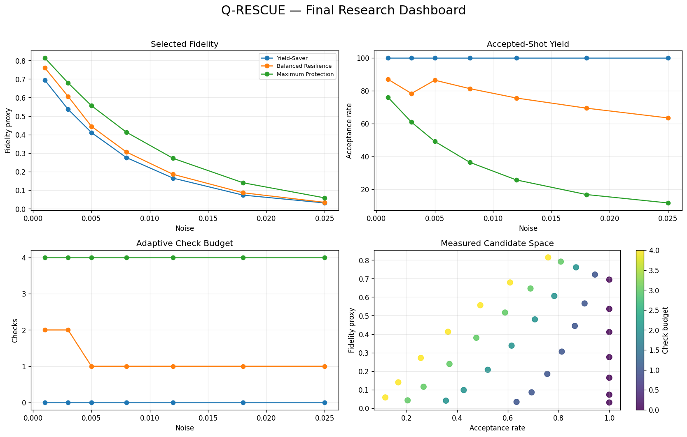
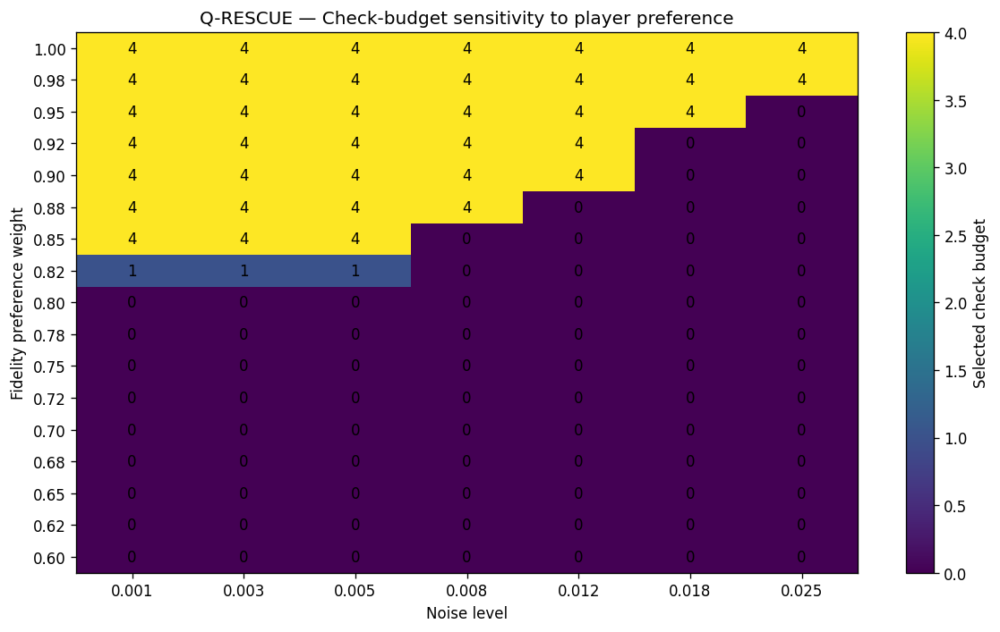

# Q-RESCUE: Resource-Aware Quantum Error Resilience

> **How much error resilience should we deploy when checks, usable shots, and circuit resources are limited?**

Q-RESCUE is a resource-aware quantum error-resilience framework built around real `qiskit-paulice` spacetime checks. It turns quantum error detection into a measurable decision problem by jointly evaluating:

- post-selected stabilizer-expectation fidelity,
- accepted-shot yield,
- circuit-resource burden.

The project does **not** claim a new quantum error-correction code. `qiskit-paulice` supplies the error-detection mechanism; Q-RESCUE adds the resource-aware measurement, Pareto analysis, policy selection, preference sensitivity, and interactive game layer.

## Key result

The validated benchmark contains **35 configurations**: 7 simulator noise levels × 5 Paulice check budgets, using an 8-qubit Clifford payload, 4,000 shots per stabilizer configuration, and 64 sampled non-identity stabilizers out of 255 available.

At the highest tested simulator noise (`0.025`) in the **stabilizer-fidelity experiment**:

| Checks | Fidelity proxy | Acceptance |
|---:|---:|---:|
| 0 | 0.03106 | 100.00% |
| 1 | 0.03273 | 63.36% |
| 2 | 0.04146 | 35.58% |
| 3 | 0.04453 | 20.50% |
| 4 | 0.05842 | 11.64% |

Thus, stronger detection improved the measured retained-sample reliability proxy, but at the cost of usable-shot yield and circuit resources.

The maximum measured fidelity proxy in this benchmark is **0.81419**, at noise `0.001` with 4 checks.

## Why Q-RESCUE?

The central research question is:

> **Given a limited resilience budget, how should error-detection resources be allocated to improve reliability without unacceptable yield/resource cost?**

Instead of optimizing fidelity alone, Q-RESCUE treats resilience as a three-way engineering trade-off:

```text
                Reliability
               /                         /                          /                      Yield ---------------- Resources
```

This produces three interpretable policies:

- **Yield-Saver** — prioritize accepted-shot yield and low resilience cost.
- **Balanced Resilience** — jointly balance fidelity, yield, and resource efficiency.
- **Maximum Protection** — select the highest measured fidelity configuration.

### Balanced policy on the validated run

| Noise | Yield-Saver | Balanced Resilience | Maximum Protection |
|---:|---:|---:|---:|
| 0.001 | 0 | 2 | 4 |
| 0.003 | 0 | 2 | 4 |
| 0.005 | 0 | 1 | 4 |
| 0.008 | 0 | 1 | 4 |
| 0.012 | 0 | 1 | 4 |
| 0.018 | 0 | 1 | 4 |
| 0.025 | 0 | 1 | 4 |

The balanced policy is a **decision rule over the measured Pareto candidates**, not a universal optimum.

## Architecture

```text
8-Qubit Clifford Payload
          |
          v
    qiskit-paulice
          |
          v
  Spacetime Check Budgets
       0 ... 4
          |
          v
      Qiskit Aer
    Controlled Noise
          |
          v
       4000 Shots
          |
       +--+--+
       |     |
   Accepted Rejected
       |
       v
Stabilizer Measurements
       |
       v
+--------------------------+
| Fidelity Proxy           |
| Acceptance / Yield       |
| Resource Burden          |
+--------------------------+
       |
       v
 Pareto Analysis
       |
       v
Resource-Aware Policies
       |
       v
Interactive Q-RESCUE Game
```

## Interactive Q-RESCUE Game

The notebook includes an interactive resource-allocation game.

A player selects:

- a **measured simulator noise level**;
- an available **resilience budget** from 0–4 checks.

The game then searches the already-evaluated benchmark configurations that fit within the selected budget and reports:

- selected checks,
- fidelity proxy,
- acceptance rate,
- resource burden,
- game score.

The interface is **not a separate toy model** and does not run a new quantum simulation during interaction. It is a front-end to the same experimentally evaluated benchmark.

The game score uses the same balanced multi-objective philosophy as the scientific decision engine: normalized fidelity, accepted-shot yield, and resource efficiency.

## Experimental design

| Factor | Value |
|---|---|
| Payload | 8-qubit Clifford circuit |
| Payload depth | 14 |
| Paulice checks | 0, 1, 2, 3, 4 actual checks |
| Noise levels | 0.001, 0.003, 0.005, 0.008, 0.012, 0.018, 0.025 |
| Main shots | 4,000 |
| Sampled stabilizers | 64 |
| Available non-identity stabilizers | 255 |
| Check construction | `method="windowed"`, `cost="gamma"` |
| Random seed | 20261004 |
| Qiskit | 2.5.2 |
| Qiskit Aer | 0.17.2 |
| qiskit-paulice | 0.2.1 |

The controlled Aer noise model uses:

- single-qubit depolarizing probability `p1 = noise_level`;
- two-qubit depolarizing probability `p2 = min(0.999, 5 × p1)`;
- readout error `min(0.25, 0.02 + noise_level)`.

This is a controlled simulator noise model, not a characterization of a specific quantum processor.

## Fidelity estimator

The 8-qubit Clifford payload has:

```text
2^8 - 1 = 255
```

non-identity stabilizers.

The benchmark samples 64 stabilizers without replacement. For each sampled stabilizer, the notebook evaluates the expectation before and after real Paulice post-selection.

The reported quantity is therefore a **64-stabilizer Monte Carlo / stabilizer-expectation fidelity proxy**, not exact full-state fidelity.

## Results

### Fidelity vs checks



### Acceptance vs checks



### High-noise trade-off



### Adaptive policy



### Final dashboard



### Preference sensitivity



## Repository structure

```text
q-rescue/
├── README.md
├── LICENSE
├── requirements.txt
├── .gitignore
├── notebooks/
│   └── Q_RES_CUE_McGill_Fall_Fest_2026_FINAL.ipynb
├── results/
│   ├── tables/
│   │   ├── paulice_stabilizer_fidelity.csv
│   │   ├── paulice_real_check_records.csv
│   │   ├── final_decision_policy.csv
│   │   ├── final_policy_check_budgets.csv
│   │   ├── final_pareto_frontier.csv
│   │   ├── weight_sensitivity.csv
│   │   └── headline_metrics.json
│   └── figures/
│       ├── 01_fidelity_vs_checks.png
│       ├── 02_acceptance_vs_checks.png
│       ├── 03_high_noise_tradeoff.png
│       ├── 04_adaptive_policy.png
│       ├── 05_final_dashboard.png
│       └── 06_weight_sensitivity.png
└── docs/
    ├── methodology.md
    └── VIDEO_DEMO_SCRIPT_3_MIN.txt
```

## Reproducibility

Clone the repository and install the pinned environment:

```bash
git clone https://github.com/YOUR_USERNAME/q-rescue.git
cd q-rescue

python -m venv .venv
```

Windows:

```bash
.venv\Scripts\activate
```

Linux/macOS:

```bash
source .venv/bin/activate
```

Then:

```bash
pip install -r requirements.txt
jupyter notebook
```

Open:

```text
notebooks/Q_RES_CUE_McGill_Fall_Fest_2026_FINAL.ipynb
```

Run the notebook top-to-bottom in a fresh environment.

The repository also contains the recorded result tables and figures accompanying the validated run, so the research outputs can be inspected without re-running the full benchmark.

## Limitations

This study should be interpreted within its demonstrated scope:

- simulator-based results only;
- 8-qubit Clifford payload;
- fidelity is a 64-stabilizer Monte Carlo / stabilizer-expectation proxy;
- no full 255-stabilizer exact state-fidelity calculation;
- no hardware performance claim;
- no fault-tolerance claim;
- no complete surface-code logical-error-rate benchmark;
- no quantum-advantage claim;
- no general non-Clifford/T-doped `qiskit-paulice` support claim.

A T-doped/non-Clifford option is intentionally not exposed in the interactive game because general non-Clifford Paulice support was not experimentally established in this study.

## Competition framing

**Track:** Quantum Error Detection, Mitigation & Correction

**Project:** Q-RESCUE — Gamified Resource-Aware Quantum Error Resilience

**Core contribution:** a resource-aware decision layer around real quantum error detection, quantified through the fidelity–yield–resource trade-off.

## Citation

If you use this repository or build on the benchmark, please cite the Q-RESCUE project and the underlying Qiskit/qiskit-paulice software used by the experiment.

## Author

**Sundram Kumar Ray**

Dual Degree: B.Tech Computer Science & Engineering, Central University of Jammu + BS Data Science & Applications, IIT Madras.
